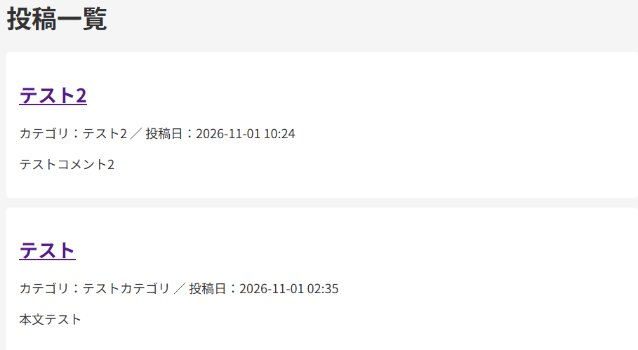
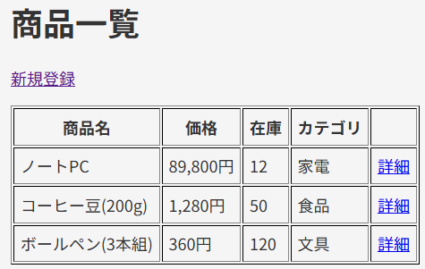
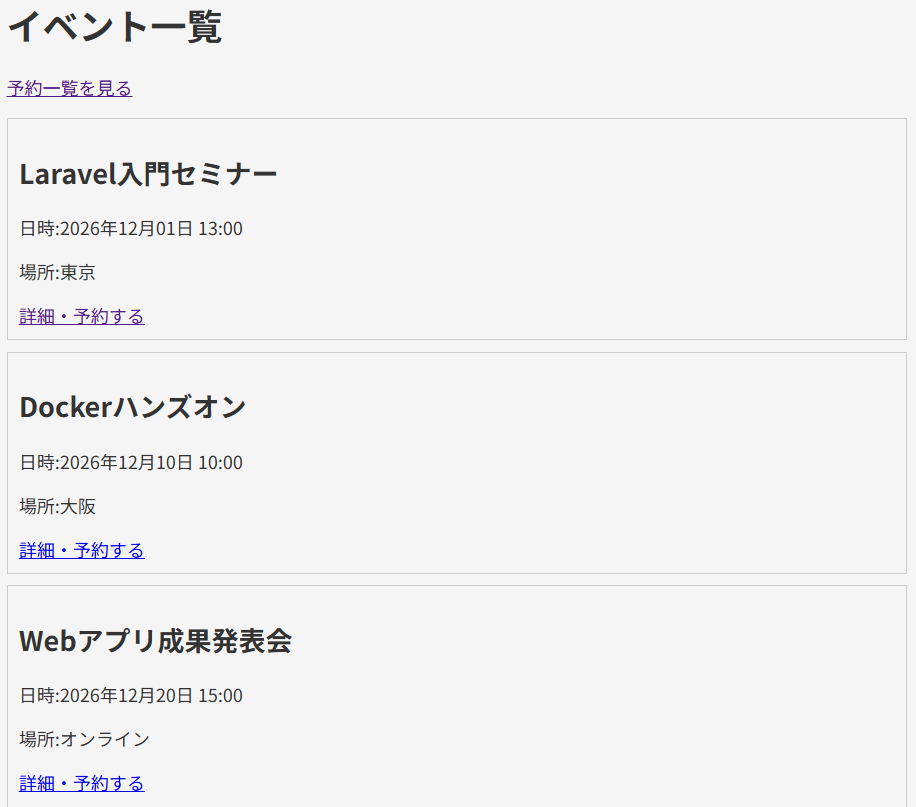
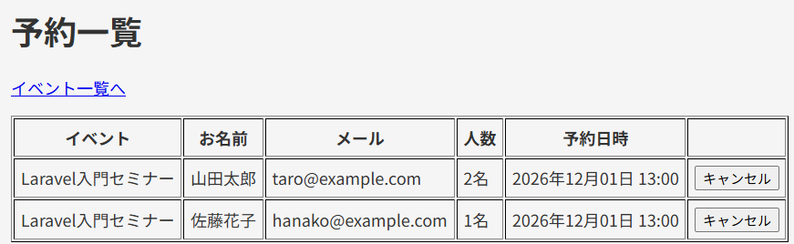

# techmeets-blog

## 概要
Docker上でLaravelを動かす開発環境です。Week 7以降、このリポジトリにブログアプリの機能を追加していきます。

## 使用技術
- PHP 8.x / Laravel
- MySQL 8.0
- Nginx
- phpMyAdmin
- Docker / Docker Compose

## セットアップ手順
```bash
git clone https://github.com/h-k-collab/techmeets-blog.git
cd techmeets-blog

# ポート番号の設定ファイルを作る(必要なら番号を変更)
cp .env.example .env

# コンテナを起動
docker compose up -d

# Laravelの準備
docker compose exec app composer install
cp src/.env.example src/.env
docker compose exec app php artisan key:generate
```

`src/.env` のDB設定を次のように書き換えます。

```
DB_CONNECTION=mysql
DB_HOST=db
DB_PORT=3306
DB_DATABASE=laravel
DB_USERNAME=root
DB_PASSWORD=secret
```

マイグレーションを実行します。

```bash
docker compose exec app php artisan migrate
```

画面の見た目(CSS・JS)をビルドします。Docker 内には Node が入っていないため、一時的な Node コンテナを使います。

```bash
docker run --rm -v "$(pwd)/src:/app" -w /app node:22 sh -c "npm install && npm run build"
```

> Windows の Git Bash では、次のように実行してください。
> ```bash
> MSYS_NO_PATHCONV=1 docker run --rm -v "$(pwd -W)/src:/app" -w /app node:22 sh -c "npm install && npm run build"
> ```

ブラウザで `http://localhost/` を開き、`/register` からユーザーを登録してログインします。

## アクセス先
- アプリケーション: http://localhost
- phpMyAdmin: http://localhost:8080

## 機能一覧
- Laravelのウェルカムページの表示
- phpMyAdminでのDB確認
- マイグレーションの実行

## ブログシステム(Laravel)

Laravel(MVC)で作った、ブログ・商品管理・イベント予約の Web アプリです。

### 機能

**ブログ(`/posts`)**
- 投稿一覧(10件ずつページネーション)・詳細表示(誰でも閲覧可能)
- 投稿の作成・編集・削除(ログインが必要)
- 自分の投稿だけ編集・削除できる(他人の投稿は403)
- 入力チェック(バリデーション)
- Blade のレイアウト継承

**認証(Laravel Breeze)**
- ユーザー登録・ログイン・ログアウト

**コメント(投稿詳細ページ)**
- コメント一覧(ログインしていなくても閲覧可能)
- ログインユーザーだけがコメントを書き込める
- 自分のコメントだけ削除できる

**商品管理(`/products`)**
- 商品の一覧・詳細・登録・編集・削除(CRUD)

**イベント予約(`/events`)**
- イベント一覧・イベント詳細
- 予約の作成(名前・メール・人数・予約日時)
- 予約一覧(`/reservations`)・予約のキャンセル

### テーブル定義

**posts(投稿)**

| カラム | 型 | 説明 |
|---|---|---|
| id | bigint | 主キー |
| title | varchar(200) | タイトル |
| content | text | 本文 |
| category | varchar(50) | カテゴリ |
| created_at / updated_at | timestamp | 作成・更新日時 |
| user_id | bigint | users.id への外部キー(投稿者) |

**products(商品)**

| カラム | 型 | 説明 |
|---|---|---|
| id | bigint | 主キー |
| name | varchar(100) | 商品名 |
| price | unsigned int | 価格 |
| description | text (null可) | 説明 |
| stock | unsigned int | 在庫(初期値0) |
| category | varchar(50) | カテゴリ |
| created_at / updated_at | timestamp | 作成・更新日時 |

**events(イベント)**

| カラム | 型 | 説明 |
|---|---|---|
| id | bigint | 主キー |
| title | varchar(100) | タイトル |
| description | text (null可) | 説明 |
| location | varchar(100) | 場所 |
| event_date | datetime | 開催日時 |
| created_at / updated_at | timestamp | 作成・更新日時 |

**reservations(予約)**

| カラム | 型 | 説明 |
|---|---|---|
| id | bigint | 主キー |
| event_id | bigint | events.id への外部キー(イベント削除時に予約も削除) |
| name | varchar(100) | 名前 |
| email | varchar(255) | メールアドレス |
| people | unsigned int | 人数 |
| reserved_at | datetime | 予約日時 |
| created_at / updated_at | timestamp | 作成・更新日時 |

**comments(コメント)**

| カラム | 型 | 説明 |
|---|---|---|
| id | bigint | 主キー |
| post_id | bigint | posts.id への外部キー(投稿削除時にコメントも削除) |
| user_id | bigint | users.id への外部キー(書いた人) |
| content | text | 本文 |
| created_at / updated_at | timestamp | 作成・更新日時 |

### 画面

**投稿一覧**



**商品一覧**



**イベント一覧**



**予約一覧**

